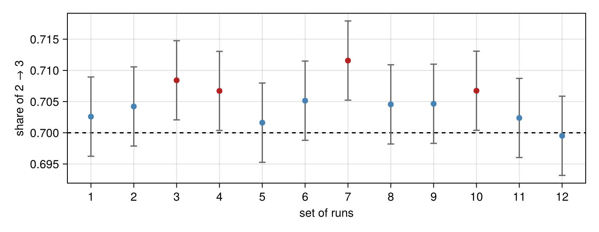

```@meta
EditURL = "../../literate/branching.jl"
```

# A branching graph

In a ring every state has one successor. This tutorial fits a graph with a choice in it, and looks at how
the branch probabilities are measured and judged.

````julia
using GenerateDynamicalNetworks
````

## The specification

The `"foraging"` example has five states. From state 2 the system goes to state 3 with probability 0.7 and to
state 4 with probability 0.3; both lead to state 5 and back to the start.

````julia
spec = example("foraging"; noise=0.1)
````

````
TransitionSpec(5 states, 6 edges, noise 0.1, sample 0.05)
````

````julia
spec.P
````

````
5×5 Matrix{Float64}:
 0.0  1.0  0.0  0.0  0.0
 0.0  0.0  0.7  0.3  0.0
 0.0  0.0  0.0  0.0  1.0
 0.0  0.0  0.0  0.0  1.0
 1.0  0.0  0.0  0.0  0.0
````

````julia
successors(spec, 2)
````

````
2-element Vector{Int64}:
 3
 4
````

````julia
spec.τ
````

````
5-element Vector{Float64}:
 2.0
 1.0
 0.5
 1.5
 1.0
````

## The fit

This time the backend is [`Synchrony`](@ref), a network of phase oscillators. Nothing else changes: `fit`
takes the specification and the backend.

````julia
model = fit(spec, Synchrony());
````

## One check

[`validate`](@ref) reports the branches as well as the dwells.

````julia
check = validate(model, spec)
````

````
Check(dwell 2.010 1.000 0.499 1.492 0.998, err% +0.5 +0.0 -0.2 -0.5 -0.2, rms 0.34%, off 0.00%, dwell ok, branches ok: PASS)
````

````julia
check.branch
````

````
2-element Vector{@NamedTuple{from::Int64, to::Int64, designed::Float64, measured::Float64, ok::Bool}}:
 (from = 2, to = 3, designed = 0.7, measured = 0.7025877171029581, ok = 1)
 (from = 2, to = 4, designed = 0.3, measured = 0.2974122828970419, ok = 1)
````

Each entry is one branch: where it goes from and to, its designed probability, the share measured, and
whether the measured share is inside the 95% interval around the designed one. The interval comes from the
number of times the branching state was left:

````julia
n = sum(check.counts[2, :])
````

````
19979
````

````julia
halfwidth = 1.96sqrt(0.7 * 0.3 / n)
````

````
0.006354462853622324
````

So with this many visits a share passes only if it is within about 0.6 percentage points of 0.7.

## The protocol

````julia
acceptance = accept(model, spec)
````

````
Acceptance: PASS
  set 1:     Check(dwell 2.010 1.000 0.499 1.492 0.998, err% +0.5 +0.0 -0.2 -0.5 -0.2, rms 0.34%, off 0.00%, dwell ok, branches ok: PASS)
  set 2:     Check(dwell 2.000 0.999 0.501 1.500 0.998, err% -0.0 -0.1 +0.2 +0.0 -0.2, rms 0.15%, off 0.00%, dwell ok, branches ok: PASS)
  half step: Check(dwell 1.999 0.999 0.498 1.492 0.999, err% -0.1 -0.1 -0.3 -0.5 -0.1, rms 0.29%, off 0.00%, dwell ok, branches ok: PASS)
````

## How much the measured share varies

That interval is narrow, and it is the range in which a model with *exactly* the designed probability lands 95
times in 100. So an exact model still fails about one check in twenty, and a model that is off by half a
percentage point fails far more often ([How strict the branch rule is](@ref)).

To see where this model stands, here are ten more sets of 64 runs, on seeds the protocol doesn't use.

````julia
starts = [9_400_001 + 200_000k for k in 0:9]
more = [validate(model, spec; seeds=s:s+63) for s in starts]
shares = [c.branch[1].measured for c in more]
````

````
10-element Vector{Float64}:
 0.7084143847573445
 0.7067092014754262
 0.7016201620162016
 0.7051474262868566
 0.7115749525616698
 0.704552276138069
 0.7046487242222998
 0.7067365269461078
 0.7023738280470776
 0.6995155087158483
````

The number of these ten sets that fail the branch rule:

````julia
count(c -> !c.branch_ok, more)
````

````
4
````

The figure shows twelve sets: the two of the protocol, then the ten more. Each bar is the 95% interval, drawn
around the measured share. A set passes when its bar reaches the dashed line at 0.7. Blue points pass and red
points fail.

````julia
using CairoMakie
CairoMakie.activate!(; type="png")

sets = [acceptance.set1; acceptance.set2; more]
measured = [c.branch[1].measured for c in sets]
half = [1.96sqrt(0.7 * 0.3 / sum(c.counts[2, :])) for c in sets]
passed = [c.branch_ok for c in sets]

fig = Figure(; size=(720, 280))
ax = Axis(fig[1, 1]; xlabel="set of runs", ylabel="share of 2 → 3", xticks=1:12)
hlines!(ax, 0.7; color=:black, linestyle=:dash)
errorbars!(ax, 1:12, measured, half; color=:gray40, whiskerwidth=8)
scatter!(ax, 1:12, measured; color=[p ? :steelblue : :firebrick for p in passed], markersize=10)
````



The points don't scatter evenly around the line: nearly all are above it. The mean over the twelve sets and
its standard error:

````julia
using Statistics
mean(measured), std(measured) / sqrt(length(measured))
````

````
(0.7048417028010984, 0.0009362136656467983)
````

So this model sends the system to state 3 about half a percentage point too often. That is less than the
half-width of the interval, which is why the model passed all three checks of the protocol, but it is enough
for four of the ten further sets to fail.

Two things follow. A model that passes has branch probabilities right to within about a percentage point at
this run length, not exactly. And a model that fails one check may be no worse than one that passes: look at
the measured shares, not only the verdict.

The dwells are a different matter. Their rule is a fixed band of 5%, and the measured means vary much less
than that from set to set:

````julia
[round.(100 .* c.err; digits=1) for c in more[1:3]]
````

````
3-element Vector{Vector{Float64}}:
 [0.0, 0.1, -0.2, -0.7, -0.2]
 [-0.3, 0.3, -0.1, -0.5, -0.3]
 [0.4, -0.1, -0.0, -0.8, -0.2]
````

## The dynamical class

````julia
classify(model, spec)
````

````
(class = :heteroclinic, outcomes = "saddle saddle saddle saddle saddle")
````

