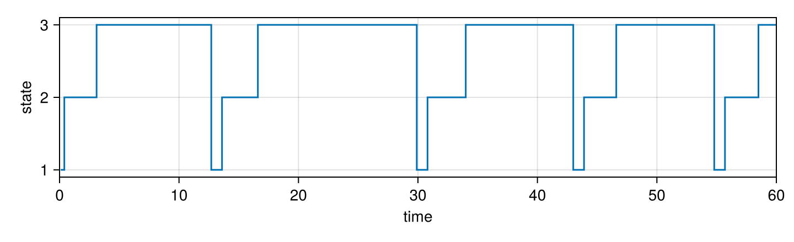
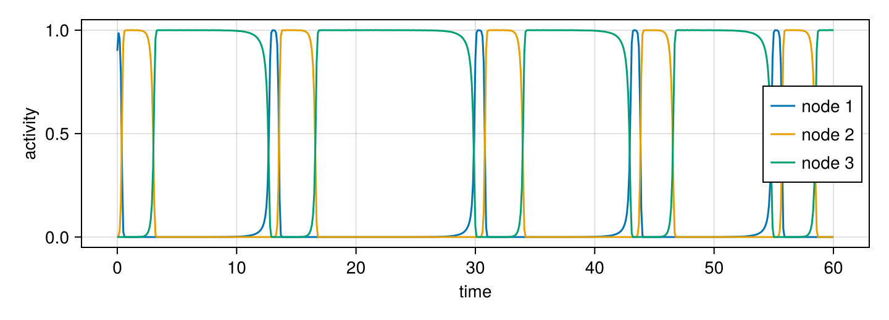
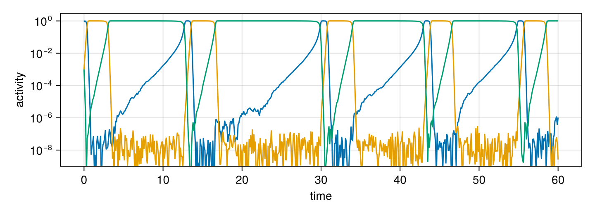
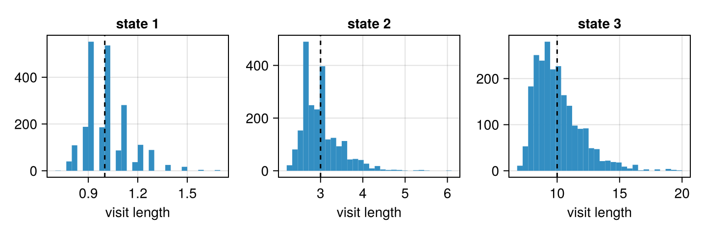

```@meta
EditURL = "../../literate/ring.jl"
```

# A three-state ring

This tutorial builds a system that visits three states in a fixed order, 1 → 2 → 3 → 1, and stays in them
for 1, 3 and 10 time units on average. It goes through every step: the specification, the fit, simulation,
measurement, acceptance and classification.

````julia
using GenerateDynamicalNetworks
````

## The specification

A [`TransitionSpec`](@ref) takes the transition matrix, the mean dwells and the noise level. [`ring`](@ref)
gives the matrix of a cycle.

````julia
spec = TransitionSpec(ring(3), [1.0, 3.0, 10.0]; noise=1e-3)
````

````
TransitionSpec(3 states, 3 edges, noise 0.001, sample 0.1)
````

````julia
spec.P
````

````
3×3 Matrix{Float64}:
 0.0  1.0  0.0
 0.0  0.0  1.0
 1.0  0.0  0.0
````

The frame interval `sample` wasn't given, so it is a tenth of the shortest dwell:

````julia
spec.sample
````

````
0.1
````

## The fit

A backend builds the system. Here it is [`Horchler`](@ref), a Lotka–Volterra network with one node per state
([Horchler](@ref horchler-backend) describes it).

````julia
model = fit(spec, Horchler(); verbose=true);
````

````
  Horchler: the correction passes pass the held-out check; no search

````

The design formula and four correction passes were enough, so the fit didn't need its search.

The model holds the parameters of the system. For this backend they are a growth rate per node and a coupling
matrix:

````julia
model.α
````

````
3-element Vector{Float64}:
 17.24008483160551
 17.24008483160551
 17.24008483160551
````

````julia
model.ρ
````

````
3×3 Matrix{Float64}:
 17.2401   34.4802  16.6405
  8.62004  17.2401  34.4802
 34.4802   14.7282  17.2401
````

## Simulating

[`simulate`](@ref) makes independent runs, one per seed. Each run is the list of states entered and the times
they were entered.

````julia
runs = simulate(model, spec; T=2000, seeds=1:16)
first_run = runs[1]
first_run.state[1:7]
````

````
7-element Vector{Int64}:
 1
 2
 3
 1
 2
 3
 1
````

````julia
round.(first_run.t[1:7]; digits=1)
````

````
7-element Vector{Float64}:
  0.1
  0.4
  3.1
 12.7
 13.6
 16.6
 29.9
````

The first minute of that run:

````julia
using CairoMakie
CairoMakie.activate!(; type="png")

fig = Figure(; size=(720, 220))
ax = Axis(fig[1, 1]; xlabel="time", ylabel="state", yticks=1:3)
stairs!(ax, first_run.t, first_run.state; step=:post)
xlims!(ax, 0, 60)
````



## Looking at the trajectory

`simulate` keeps only the visits. To see the variables themselves, solve the model's equation directly. Every
model supplies its drift, noise, parameters and starting point
([Internals and the backend interface](@ref)); these aren't exported, so they are called with the module name.

````julia
using SciMLBase, StochasticDiffEqLowOrder
const GDN = GenerateDynamicalNetworks

every, dt = GDN.frame_steps(model, spec.sample, 0.01)
problem = SDEProblem(GDN.drift_function(model), GDN.noise_function(model), GDN.initial_state(model), (0.0, 60.0),
                     GDN.parameters(model); seed=UInt64(1))
sol = solve(problem, EM(); dt, saveat=spec.sample);
````

This uses the simulator's own step and the seed of the first run, so it is the same run as `first_run` above.

The model is in the `u` form, where the activity of node ``i`` is ``u_i^2``. One node is active at a time, and
the next one takes over quickly after a long wait.

````julia
fig = Figure(; size=(720, 260))
ax = Axis(fig[1, 1]; xlabel="time", ylabel="activity")
for i in 1:3
    lines!(ax, sol.t, [u[i]^2 for u in sol.u]; label="node $i")
end
axislegend(ax; position=:rc)
````



On a log scale the waiting is visible: while one node is active, the next grows exponentially from the noise
level until it takes over. That growth is what sets the dwell. The colours are as above.

````julia
fig = Figure(; size=(720, 260))
ax = Axis(fig[1, 1]; xlabel="time", ylabel="activity", yscale=log10)
for i in 1:3
    lines!(ax, sol.t, [max(u[i]^2, 1e-12) for u in sol.u]; label="node $i")
end
ylims!(ax, 1e-9, 3)
````



## Measuring

[`measure`](@ref) pools the runs. The mean dwells are close to the targets 1, 3 and 10:

````julia
m = measure(runs, nstates(spec))
m.dwell
````

````
3-element Vector{Float64}:
  1.0052956752485473
  3.004385965060385
 10.053771504683901
````

````julia
m.sem
````

````
3-element Vector{Float64}:
 0.002865945779272145
 0.00951827856110362
 0.039134647646891105
````

`m.samples` has every visit length. The dwells of a system like this are far from exponential: each visit is
a wait of similar length.

````julia
fig = Figure(; size=(720, 240))
for i in 1:3
    ax = Axis(fig[1, i]; title="state $i", xlabel="visit length")
    hist!(ax, m.samples[i]; bins=30)
    vlines!(ax, spec.τ[i]; color=:black, linestyle=:dash)
end
````

````
┌ Warning: Assignment to `ax` in soft scope is ambiguous because a global variable by the same name exists: `ax` will be treated as a new local. Disambiguate by using `local ax` to suppress this warning or `global ax` to assign to the existing global variable.
└ @ ~/Programming/GenerateDynamicalNetworks.jl/docs/src/tutorials/ring.md:3

````



The dashed lines are the targets.

## Acceptance

The 16 runs above are only a look. [`validate`](@ref) makes one acceptance check on 64 held-out seeds:

````julia
check = validate(model, spec)
````

````
Check(dwell 1.004 2.992 10.017, err% +0.4 -0.3 +0.2, rms 0.28%, off 0.00%, dwell ok, branches ok: PASS)
````

[`accept`](@ref) makes the whole protocol: two sets of seeds, and the first set again at half the step
([The acceptance rule](@ref)).

````julia
acceptance = accept(model, spec)
````

````
Acceptance: PASS
  set 1:     Check(dwell 1.004 2.992 10.017, err% +0.4 -0.3 +0.2, rms 0.28%, off 0.00%, dwell ok, branches ok: PASS)
  set 2:     Check(dwell 1.005 2.990 10.031, err% +0.5 -0.3 +0.3, rms 0.39%, off 0.00%, dwell ok, branches ok: PASS)
  half step: Check(dwell 1.003 2.995 10.023, err% +0.3 -0.2 +0.2, rms 0.23%, off 0.00%, dwell ok, branches ok: PASS)
````

````julia
acceptance.pass
````

````
true
````

A ring has no branches, so the branch rule has nothing to test here. [A branching graph](@ref) is about that
rule.

## The dynamical class

[`classify`](@ref) switches the noise off and looks at where the system goes.

````julia
classify(model, spec)
````

````
(class = :heteroclinic, outcomes = "saddle saddle saddle saddle saddle")
````

From all five starting points the noise-free system comes to rest at a saddle, so the model is heteroclinic:
it needs noise to leave each state ([Dynamical classes](@ref)).

