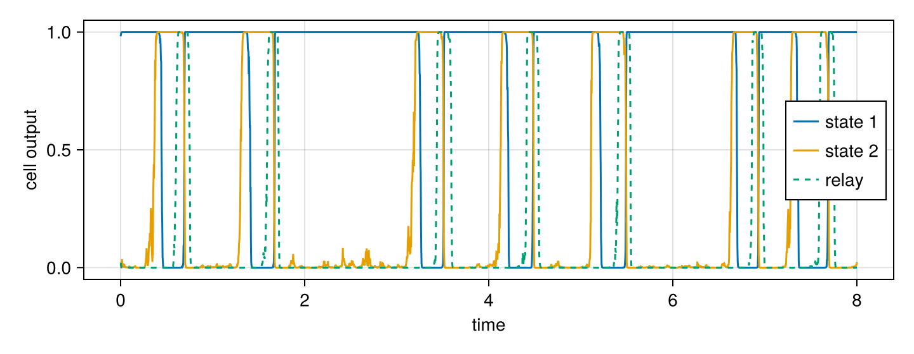

```@meta
EditURL = "../../literate/two_way.jl"
```

# A two-way graph

A two-way edge is a pair of states that each follow the other. Some constructions can't represent one
directly and need extra cells that aren't states. This tutorial fits the smallest such graph, two states that
alternate, and looks at the extra cell.

````julia
using GenerateDynamicalNetworks
const GDN = GenerateDynamicalNetworks
````

````
GenerateDynamicalNetworks
````

## The specification

The `"flip-flop"` example: state 1 lasts 1 time unit on average and state 2 lasts 0.3.

````julia
spec = example("flip-flop"; noise=0.1)
````

````
TransitionSpec(2 states, 2 edges, noise 0.1, sample 0.03)
````

````julia
spec.P
````

````
2×2 Matrix{Float64}:
 0.0  1.0
 1.0  0.0
````

## Hidden states in the Horchler backend

The Lotka–Volterra construction of [`Horchler`](@ref) can't have two nodes that each lead to the other. Its
design first puts a hidden state on one of the two edges ([Graphs that need hidden states](@ref)):

````julia
r = GDN.repair(spec.P, spec.τ)
r.reasons
````

````
1-element Vector{String}:
 "2-cycle 1 ⇄ 2"
````

````julia
r.P
````

````
3×3 Matrix{Float64}:
 0.0  0.0  1.0
 1.0  0.0  0.0
 0.0  1.0  0.0
````

The graph now has three nodes in a ring, 1 → 3 → 2 → 1. Node 3 is hidden: the decoder never reports it, and
the time spent there counts towards state 1.

## Relay cells in the CTRNN backend

[`CTRNNDesign`](@ref) builds a continuous-time recurrent neural network with one cell per state. While one
cell is on, it holds back each cell that can follow it only weakly, and noise eventually fires one of them.
The cell that fires then switches the others off through strongly negative weights.

For a two-way pair that plan asks one weight to do two jobs. The weight from cell 2 to cell 1 would have to
be strongly negative, so that cell 2 switches cell 1 off when it fires, and close to zero, so that noise can
fire cell 1 while cell 2 is on. The design therefore sends one direction of the pair through a hidden *relay*
cell: noise fires the relay, and the relay switches the state cell on.

````julia
model = fit(spec, CTRNNDesign());
````

The model has three cells, of which the first two are states:

````julia
size(model.W, 1), model.visible
````

````
(3, 2)
````

The weights, with `W[i, j]` the weight from cell `j` to cell `i`:

````julia
round.(model.W; digits=2)
````

````
3×3 Matrix{Float64}:
  0.23  -0.35   0.46
 -0.05   0.23  -0.35
 -0.35   0.01   0.23
````

- `W[2, 1]` is the edge 1 → 2: while cell 1 is on, cell 2 is held back only weakly.
- `W[1, 2]` is strongly negative: when cell 2 fires it switches cell 1 off.
- The edge 2 → 1 goes through cell 3, the relay. `W[3, 2]` is close to zero, so the relay is barely held back
  while cell 2 is on, and `W[1, 3]` is the relay driving cell 1 on. In this fit `W[3, 2]` came out slightly
  positive: the relay isn't held back at all, and rises by itself once cell 2 is on.

## Acceptance

````julia
acceptance = accept(model, spec)
````

````
Acceptance: PASS
  set 1:     Check(dwell 0.995 0.300, err% -0.5 +0.0, rms 0.37%, off 0.00%, dwell ok, branches ok: PASS)
  set 2:     Check(dwell 0.999 0.299, err% -0.1 -0.2, rms 0.18%, off 0.00%, dwell ok, branches ok: PASS)
  half step: Check(dwell 1.002 0.299, err% +0.2 -0.3, rms 0.25%, off 0.00%, dwell ok, branches ok: PASS)
````

## Seeing the relay

As in [A three-state ring](@ref), the trajectory comes from solving the model's equation directly. A cell's
output is the logistic function of ``g\,(y_i + b_i)``.

````julia
using SciMLBase, StochasticDiffEqLowOrder

every, dt = GDN.frame_steps(model, spec.sample, 0.01)
q = GDN.parameters(model)
problem = SDEProblem(GDN.drift_function(model), GDN.noise_function(model), GDN.initial_state(model), (0.0, 8.0), q;
                     seed=UInt64(1))
sol = solve(problem, EM(); dt, saveat=spec.sample / 10)
output(y, i) = 1 / (1 + exp(-q.g * (y[i] + q.b[i])));
````

````julia
using CairoMakie
CairoMakie.activate!(; type="png")

fig = Figure(; size=(720, 280))
ax = Axis(fig[1, 1]; xlabel="time", ylabel="cell output")
for (i, label) in enumerate(["state 1", "state 2", "relay"])
    lines!(ax, sol.t, [output(y, i) for y in sol.u]; label, linestyle=i == 3 ? :dash : :solid)
end
axislegend(ax; position=:rc)
````



State 2 follows state 1 directly. On the way back the relay fires first, at the end of a visit to state 2,
and state 1 comes on right after it. The relay then switches off again.

## The dynamical class

````julia
classify(model, spec)
````

````
(class = :excitable, outcomes = "stable stable stable stable stable")
````

Without noise the system settles at a stable equilibrium: each state is a resting point, and noise is what
carries the system over the threshold to the next one. This model is excitable, unlike the heteroclinic
models of the other two tutorials ([Dynamical classes](@ref)).

